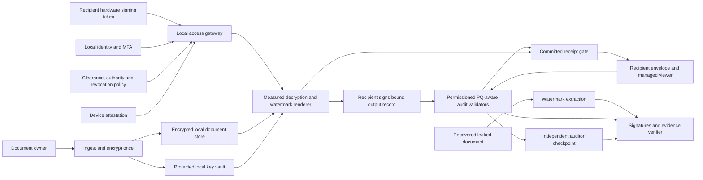
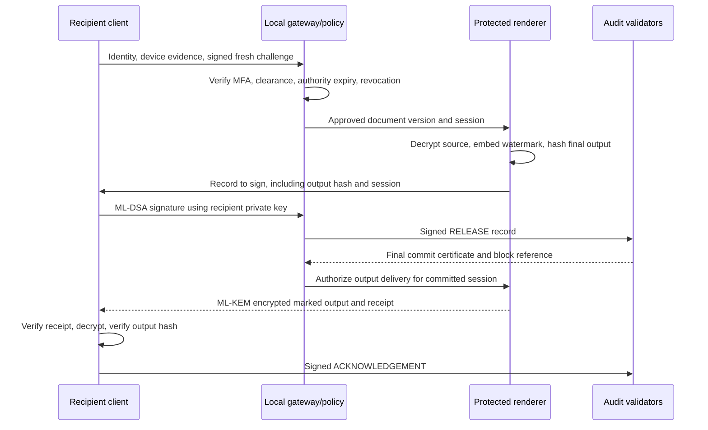

# Technical Design Document

## 1. Scope and threat model

The official statement requires decryption-time invisible recipient/session watermarks, recipient private-key signatures, NIST-standardized PQ exchange/signatures, an immutable blockchain/DLT audit layer, extraction and verification from leaked documents, and entirely offline air-gapped operation. VAJRA targets those requirements through a controlled document-rendering boundary.

Adversaries include recipients stripping or transplanting marks, a compromised administrator editing logs, replayed access requests, stolen credentials, compromised workstations, and a malicious validator. A sender or renderer that controls the original plaintext remains trusted. The system cannot prevent a trusted source owner from leaking the source. It cannot establish a human leaker solely from a matching fingerprint.

## 2. Proposed production architecture

All components run on a disconnected local network. An air-gapped enclave can have an internal LAN. A device isolated from that LAN cannot obtain a fresh quorum receipt: strict mode blocks new opens. Offline access through pre-issued capabilities is a separate weaker mode and must not be advertised as providing immediate global provenance. It is excluded from this prototype.

### Trust boundaries

| Boundary | Responsibility | Required protection |
|---|---|---|
| Recipient | Owns signing key, confirms signed request | Hardware key protection, PIN/MFA and trusted signing display |
| Decryption renderer | Sees original plaintext and creates final marked output | Measured execution, sandbox, key isolation and restricted output paths |
| Ledger operators | Validate evidence and preserve order | Separate organizations/administrators and PQ-aware quorum rules |
| Auditor | Pins enrollment keys and ledger checkpoints | Separate storage, dual-control updates and retention |
| Time authority | Attests observed time | Signed local time, hardware clock checks and stated uncertainty |

The sender encrypts once for distribution. Recipient-specific access produces fresh envelopes for marked outputs. **Do not distribute the unrestricted original content key to recipients.** Otherwise they can decrypt the identical source without marking or ledger commitment, defeating the main requirement.

## 3. Session sequence and failure states

- Denial: no output. Production records signed rejection reason codes while minimizing identity leakage. The demo throws an error and has no signed denial ledger event.
- Quorum unavailable: no output release. A strict availability/integrity tradeoff is intentional.
- Release committed, delivery failed: preserve RELEASE without ACK. Retry uses the same stored marked output and session through an idempotent delivery endpoint. Prototype does not implement delivery retry persistence.
- Output received, acknowledgement lost: RELEASE remains verifiable. Human-read status is unknown. A production client uses a durable outbox for acknowledgements.
- Broker crash/partial disk writes: recover from the latest externally pinned quorum checkpoint, reconcile replicas, and block output until recovery completes. The demo uses ordinary file writes and is not crash-atomic.
- Concurrent requests: production uses consensus state transitions and unique request IDs. The demo requires a single CLI process at a time and provides no interprocess locking.

## 4. Cryptographic design

- Source: random 256-bit content key, AES-256-GCM with fresh 96-bit nonce. AAD binds source document ID, version, classification, authorized recipients and authority.
- Session delivery: ML-KEM-768 encapsulation, HKDF-SHA256 with a domain-specific label, AES-256-GCM with fresh nonce and session-specific AAD.
- Records: deterministic sorted-key JSON for this bounded schema, domain/type/schema separation, ML-DSA-65 recipient signatures. Production specifies a canonical encoding shared across languages and rejects duplicate JSON keys and unknown fields.
- Receipt: hash-linked blocks with three distinct ML-DSA validator signatures out of four. Trust keys must be enrolled and independently pinned.
- Key lifecycle: production separates recipient signature/KEM keys from broker and validator keys, supports dual-control enrollment/rotation, pins key versions in records, revokes future access, archives verification keys and cryptographic suites, and securely destroys retired decryption keys subject to retention.
- Private-key zeroization is incomplete in managed runtimes and PEM strings cannot be reliably cleared. The prototype is unsuitable for live secrets.

NIST algorithm standardization does not certify this implementation. Crypto agility includes schema/suite versioning, downgrades rejected by policy, PQ migration of transport/node authentication and protected backup keys. PQ application signatures alone do not make every ledger framework quantum-safe.

## 5. Decryption watermark

### Implemented baseline

The demo appends 128 invisible zero-width bits encoding a random 128-bit session ID to UTF-8 text with delimiters. It never encodes a person's name or document text in the watermark. The release record binds the entire final output digest to the session. Two copies render the same ordinary text after removal of the reserved codepoints. The extractor rejects missing/ambiguous marks and the investigator rejects unknown sessions or a digest mismatch. This blocks exact-copy mark transplantation in the demonstrated scope.

This is a deliberately weak baseline watermark. It is trivial to remove by sanitization. It does not address raster documents, PDF transforms, print/scan, screenshots, or averaging collusion. No claim of robustness against those attacks is made.

### Production watermark work package

Prototype format-specific PDF/image watermarking with encrypted pseudorandom session codes, error correction and repetition across page regions. Candidate channels include constrained text-position perturbations and spread-spectrum raster marks below a validated perceptual threshold. Test extraction on transformed copies; compare visual similarity against the source. Do not rely only on PDF metadata or hidden text, which re-exporting can discard. Use separate detector keys so an investigator cannot forge recipient signatures. Consider collusion-resistant fingerprint codebooks rather than simple serial identifiers.

For transformed copies, the original byte digest will differ. The evidence report must distinguish a statistical watermark match from an exact-copy match. Report detector confidence, threshold, measured false-positive rate, transformation, version and corroborating evidence. Require a reviewer to evaluate transformed-copy attribution. Never report a stripped mark as proof of innocence or a weak correlation as proof of guilt.

### Acceptance matrix (planned, not measured)

| Test | Method | Required evidence |
|---|---|---|
| Exact copy | 1,000 synthetic sessions | Correct session match and no cross-recipient match |
| Visual similarity | Pixel comparison and human inspection | Format-specific perceptual acceptance threshold |
| PDF re-export | Multiple independent renderers | Extraction success by renderer and document type |
| Screenshot/JPEG | Several resolutions and qualities | Success rate versus quality and page crop |
| Print/scan | Several DPI settings and rotations | Detection confidence and failure conditions |
| Collusion | Compare/average 2-5 recipient copies | Resistance results, no universal claim |
| False attribution | Unmarked and unrelated corpus | False-positive rate with confidence interval |
| Transplant | Copy mark to unrelated content | Flag content inconsistency, never assert certain attribution |

## 6. Audit ledger and immutability

**Executable demo:** a single coordinator holds four logical replica files and all validator private keys. It signs each proposed block with available validators. Verification requires at least three complete chains matching the trusted checkpoint. This shows certificate verification and failure gating. It does not implement networking, leader election, PBFT/QBFT, Byzantine fork prevention or cross-admin persistence.

**Production:** four independent validators allow a conventional BFT design to tolerate one Byzantine validator under its quorum, authenticated-channel and network assumptions. Use an audited consensus engine. PQ validation of application records and quorum certificates is required; evaluate how node authentication, consensus signatures and state recovery also migrate to PQ. Each node independently checks schema, recipient identity, signature, policy evidence, session uniqueness and predecessor before voting. Commit order and quorum cannot depend on one broker's discretion. Store independently signed checkpoints under auditor control. Adding validators requires an audited membership change rather than merely changing quorum numbers.

Permissioned ledger entries carry opaque document IDs, session commitments, output digests and policy/key references. Keep names, clearance, plaintext, original encryption keys and sensitive authority details off-chain in an encrypted evidence store with access control and retention policy. The demo includes synthetic names for readability. On-chain hashes can still leak correlations; use secret/random commitments where dictionary guessing is a concern.

## 7. Implementation mapping

| Requirement | Prototype | Production gap |
|---|---|---|
| Recipient/session watermark | Invisible UTF-8 exact-copy code | Robust PDF/image channels and collusion evaluation |
| Recipient signature | Real ML-DSA-65 | Hardware-owned signing key and consent ceremony |
| PQ key exchange | Real ML-KEM-768 | Protected endpoint keys and transport migration |
| Immutable DLT | Hash chain and logical 3-of-4 certificate | Independent nodes and audited BFT consensus |
| Leak extraction | Exact copy extraction + output hash | Detector confidence on transformed copies |
| Offline operation | No runtime network dependencies | Offline provisioning/update/certificate processes |
| Device/authority/time | Synthetic policy checks and host time | Attestation, MFA, signed policy/time evidence |

## 8. Evaluation and roadmap

1. Baseline: validate functional roundtrip, signatures, watermark uniqueness, authorization, revocation, expiry, replay rejection, quorum failure and tamper detection. Included automated tests implement this stage.
2. Format stage: robust PDF renderer, image watermark detector and attack corpus. Ship only transformations with measured confidence.
3. Trust stage: recipient token integration, renderer hardware boundary, independently administered ledger nodes and local time/identity services.
4. Pilot stage: load tests, crash recovery, revocation races, key rotation, administrative compromise and red-team exercises on synthetic data.

Engineering targets for a pilot could include p95 access latency below 3 seconds for a 10 MB PDF over the enclave LAN and 100 concurrent sessions. These are proposed targets, not benchmarks. Measure cryptography, rendering and consensus separately and document hardware, file type and validator count.

## 9. Sources

Official scope: https://sih.gov.in/sih2026PS, SIH26237. Algorithms: https://csrc.nist.gov/pubs/fips/203/final and https://csrc.nist.gov/pubs/fips/204/final. Runtime: https://nodejs.org/docs/latest-v24.x/api/crypto.html. BFT example documentation: https://besu.hyperledger.org/private-networks/how-to/configure/consensus/qbft. The architecture, threat analysis and watermark roadmap above are this project's proposal.
